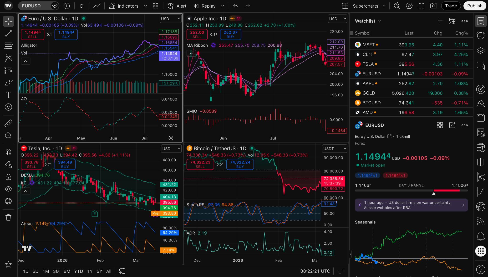
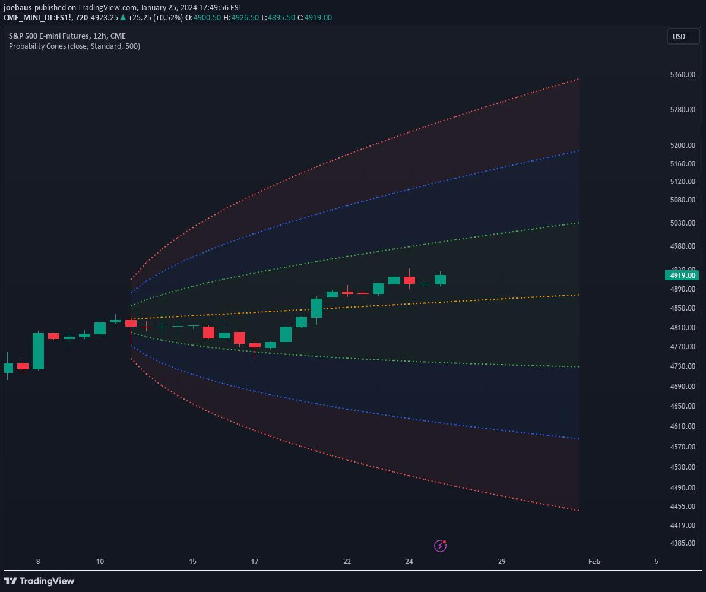
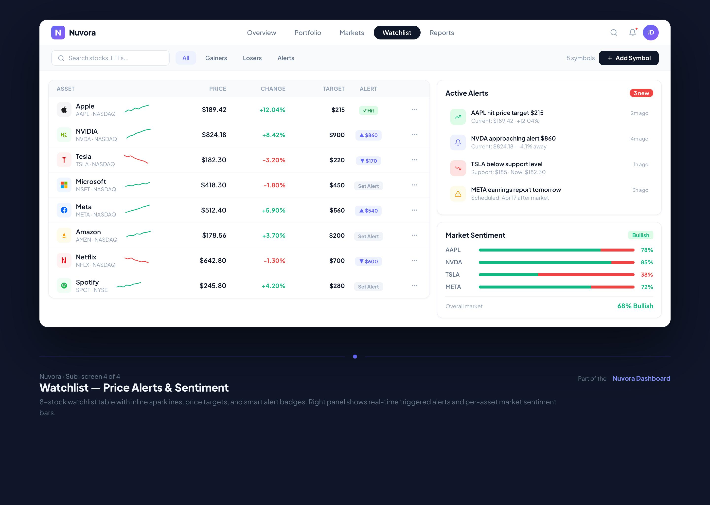

# What I knew after first interview

<blockquote class="em-quote">
  The task is to build an unpolished prototype on what we are calling price formation. If the price is high then we need to show the user insight into what drives it.
</blockquote>

---

# What I did first

I asked my favorite AI to generate a prompt for Claude Code to make a prototype.

```markdown
# Build a Price Formation Explorer – Electricity Maps Product Prototype

## Context

I'm preparing a product engineering case for Electricity Maps.

Electricity Maps provides electricity market data and forecasting
to energy traders and other market participants.

One of the challenges traders face is understanding why electricity
prices behave the way they do.
[...]
```
<em class="text-xs light-grey">\[snip 340 more lines]</em>


---

# Demo 1

<div class="em-embed">
  <iframe src="http://localhost:5173/" title="Demo"></iframe>
</div>

---

# The actual work

After getting the actual challenge I did a bit of research.

<div class="grid gap-3 mt-4 text-sm" style="grid-template-columns: repeat(3, 1fr) 1fr 1fr">
  <div class="p-3 rounded border border-primary/20 bg-primary/10">
    <div class="text-xs opacity-60 mb-1">Trader dashboard<br/><br/></div>
    <Lightbox></Lightbox>
  </div>

  <div class="p-3 rounded border border-primary/20 bg-primary/10">
    <div class="text-xs opacity-60 mb-1">Probability based forecasts</div>
    <Lightbox></Lightbox>
  </div>

  <div class="p-3 rounded border border-primary/20 bg-primary/10">
    <div class="text-xs opacity-60 mb-1">Forecast sentiment and alerts</div>
    <Lightbox></Lightbox>
  </div>

  <div class="p-3 rounded border border-primary/20 bg-primary/10">
    <div class="text-xs opacity-60 mb-1">Fortune telling<br/><br/></div>
    <Lightbox></Lightbox>
  </div>

</div>

<div class="text-xs light-grey mt-5 mb-5">
What different UX solutions exist in the market for the types of users I imagine using this?
What user archetypes do I foresee using this - i.e. not their actual titles, but what profile
matches their behaviour best?
</div>

<div class="text-xs light-grey">

* Day-traders - *those who care about by-the-minute updates*
* Meterologists - *those who care about long term*
* CSI - *those who what to know what went wrong*

</div>

---

# Demo 2

<div class="em-embed">
  <iframe src="/price-detective/index.html" title="Price Detective"></iframe>
</div>

---

# Next Steps

What I would do if I were to actually implement this?

<div class="text-sm mb-5">

Everything you see (including these slides - written in [sli.dev](https://sli.dev)) is pretty much vibe-coded.
It takes a good amount of human-in-the-loop to build something production-ready.

* Local minima/maxima detection
* Trend-change detection
* Backend-for-frontend - slim frontend at the cost of tighter coupling
* APIs and models
* Core components

Only then:

* Claude (or similar) for glueing the pieces together

</div>
